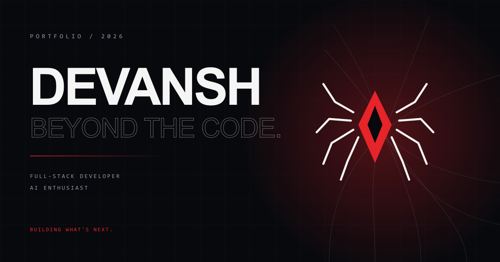

# Devansh Avchat — Beyond the Code

A premium, spider-inspired developer portfolio for **Devansh Avchat**, a full-stack developer and AI enthusiast based in Nagpur, India.

The site pairs an editorial, high-contrast visual system with an interactive hero: an original upside-down masked character hangs from a procedural web and reacts to the pointer through spring physics. Everything below the fold is built for clarity: real projects, real links, honest copy, and no invented metrics.



## Design concept

- **Editorial dark theme.** Ink-black surfaces, off-white type, and a single red accent.
- **Web as a system.** Procedural web patterns, corner webs, and a physics-driven string connect the visual language to the character.
- **Motion with restraint.** GSAP handles entrance and scroll choreography; Lenis handles smooth scrolling; reduced-motion preferences disable the heavy movement.
- **Typography as hierarchy.** Space Grotesk for display, Inter for reading, JetBrains Mono for labels and metadata.

## Features

- Original hanging spider character with spring physics, pointer follow, idle sway, string bending, click impulse, and an entrance drop
- Responsive hero with GSAP entrance timeline and parallax
- Scroll-spy navigation, animated mobile menu, and Lenis smooth scrolling
- About, selected projects, skills, journey timeline, and contact sections
- Expandable project cards with stack, highlights, repository, and live links
- Contact form with React Hook Form + Zod validation and an honest delivery state
- Next.js metadata, JSON-LD, Open Graph image, sitemap, robots, manifest, and custom 404
- Accessibility: skip link, semantic landmarks, focus styles, keyboard-friendly interactions, and `prefers-reduced-motion` support
- Generated project previews, favicon, Apple icon, OG cover, and resume PDF

## Stack

| Layer | Tools |
| --- | --- |
| Framework | Next.js 16 (App Router, Turbopack), React 19, JavaScript (JSX) |
| Styling | Tailwind CSS v4, custom design tokens and utilities |
| Motion | GSAP, `@gsap/react`, Lenis |
| UI utilities | `lucide-react`, `clsx`, `tailwind-merge`, `class-variance-authority` |
| Forms | React Hook Form, Zod, `@hookform/resolvers` |
| Email | Resend (optional, via API route) |
| Assets | Sharp, custom Node scripts |

## Project structure

```text
src/
  app/                 App Router pages, metadata routes, API route
  components/
    art/               Procedural webs and decorative SVGs
    hero/              Spider character and spring-physics scene
    layout/            Navbar, footer, smooth scroll provider
    sections/          Hero, about, projects, skills, journey, contact
    ui/                Buttons, headings, cards, social icons, reveals
  lib/
    data/              Projects, skills, and journey content
    site.js            Identity, links, navigation, education
scripts/               Asset optimization and resume generation
public/
  assets/projects/     Optimized project previews
  og.png               Social share cover
  resume.pdf           Downloadable resume
```

All editable content lives in `src/lib/site.js`, `src/lib/data/projects.js`, `src/lib/data/skills.js`, and `src/lib/data/journey.js`.

## Getting started

Requirements: Node.js 20.9 or newer.

```bash
npm install
npm run dev
```

Open [http://localhost:3000](http://localhost:3000).

```bash
npm run lint        # ESLint
npm run build       # Production build
npm run start       # Serve the production build
npm run assets      # Re-optimize project preview images
npm run resume      # Regenerate public/resume.pdf
```

## Environment variables

Copy `.env.example` to `.env.local` and fill in what you need.

| Variable | Required | Purpose |
| --- | --- | --- |
| `NEXT_PUBLIC_SITE_URL` | Recommended | Canonical URL used by metadata, sitemap, robots, and JSON-LD. Defaults to `http://localhost:3000`. |
| `RESEND_API_KEY` | For email delivery | Resend API key used by `/api/contact`. |
| `CONTACT_TO_EMAIL` | For email delivery | Inbox that receives form submissions. |
| `CONTACT_FROM_EMAIL` | For email delivery | Verified sender address. The Resend test sender works only for test sends. |

Without `RESEND_API_KEY`, the API returns HTTP 503 with `EMAIL_NOT_CONFIGURED`, and the form tells visitors to email directly. It never claims a message was delivered when it was not.

## Contact form delivery

`src/app/api/contact/route.js` validates submissions with the shared Zod schema, applies basic length limits, and sends mail through Resend when configured. To use it in production:

1. Create a Resend account and API key.
2. Verify your sending domain, then set `CONTACT_FROM_EMAIL` to an address on that domain.
3. Set `CONTACT_TO_EMAIL` to the inbox you actually monitor.
4. Add all three variables to your deployment environment.

## Deployment

The project deploys to Vercel without configuration changes:

1. Push the repository to GitHub.
2. Import the repository in Vercel.
3. Add the environment variables above, with `NEXT_PUBLIC_SITE_URL` set to the production domain.
4. Deploy, then update `NEXT_PUBLIC_SITE_URL` if Vercel assigns a different primary domain.

Any Node.js host that supports Next.js 16 works as well. Run `npm run build` followed by `npm run start`.

## Replacing content and assets

- Update identity, links, availability, and education in `src/lib/site.js`.
- Update projects in `src/lib/data/projects.js`; keep repository and live URLs accurate.
- Replace source artwork in `public/assets/projects/src/` and run `npm run assets`.
- Edit the resume data in `scripts/generate-resume.mjs` and run `npm run resume`.
- Replace `public/og.png` when the visual identity changes.

Never publish placeholder metrics, testimonials, or links that do not exist.

## License

MIT © 2026 Devansh Avchat. See [LICENSE](./LICENSE).
